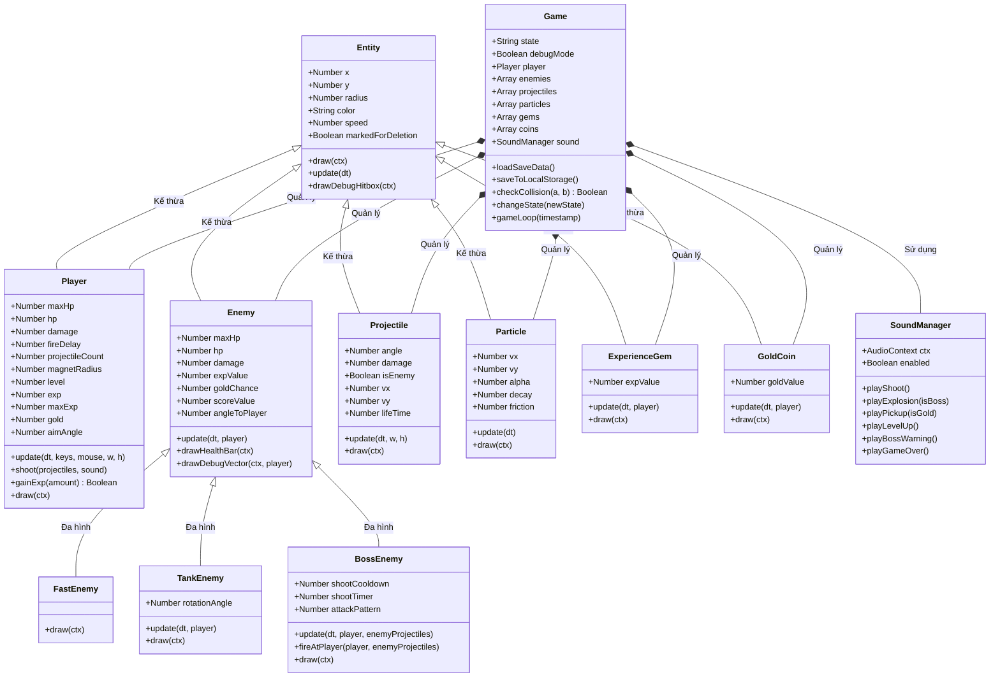

# BÁO CÁO BÀI TẬP LỚN HỌC PHẦN: THỰC TẬP CƠ SỞ NGÀNH CÔNG NGHỆ THÔNG TIN

**TÊN ĐỀ TÀI:** XÂY DỰNG GAME 2D TOP-DOWN SURVIVAL SHOOTER "CYBER SURVIVOR 2077" BẰNG HTML5 CANVAS VÀ JAVASCRIPT HƯỚNG ĐỐI TƯỢNG (ES6 OOP)

- **Kho lưu trữ mã nguồn (GitHub):** https://github.com/hevos-s/Game-CYBER-SUVIVAR-2077

---

## LỜI NÓI ĐẦU

Trong chương trình đào tạo ngành Công nghệ thông tin, học phần **Thực tập cơ sở** đóng vai trò cầu nối quan trọng giúp sinh viên vận dụng các kiến thức nền tảng về Lập trình Hướng đối tượng (Object-Oriented Programming - OOP), Cấu trúc dữ liệu & Giải thuật, Toán học tính toán và Kỹ thuật phần mềm vào một sản phẩm thực tế hoàn chỉnh.

Đề tài **"Xây dựng tựa game 2D Top-Down Survival Shooter - Cyber Survivor 2077"** được thực hiện nhằm minh họa trực quan cách tổ chức kiến trúc phần mềm hướng đối tượng bằng ngôn ngữ JavaScript chuẩn ES6, kết hợp với đồ họa 2D thời gian thực trên HTML5 Canvas API và bộ tổng hợp âm thanh sóng âm thuần túy bằng Web Audio API mà không phụ thuộc vào bất kỳ thư viện hay game engine bên thứ ba nào.

---

## CHƯƠNG 1: TỔNG QUAN VỀ ĐỀ TÀI VÀ CÔNG NGHỆ SỬ DỤNG

### 1.1. Lý do chọn đề tài và Mục tiêu đồ án
- **Về mặt học thuật:** Phát triển game 2D thời gian thực là một bài toán điển hình của Lập trình Hướng đối tượng. Trên màn hình cùng lúc xuất hiện hàng trăm thực thể (nhân vật, các chủng loại quái vật, đạn, hạt nổ, vật phẩm rơi). Nếu không áp dụng tốt **Đóng gói (Encapsulation)**, **Kế thừa (Inheritance)** và **Đa hình (Polymorphism)**, mã nguồn sẽ nhanh chóng trở nên rối rắm và khó bảo trì.
- **Về mặt kỹ thuật:** Đồ án đặt mục tiêu xây dựng một trò chơi hoàn chỉnh có thể chạy trực tiếp trên mọi trình duyệt web qua giao thức `file://` (nháy đúp vào `index.html`) mà không cần cài đặt máy chủ hay công cụ đóng gói phức tạp.

### 1.2. Tổng quan thể loại 2D Top-Down Survival Shooter
Lấy cảm hứng từ dòng game sinh tồn *Vampire Survivors*, người chơi điều khiển một chiến binh công nghệ (Cyber Warrior) ở góc nhìn từ trên xuống (Top-Down), liên tục di chuyển và xoay nòng súng 360 độ để tiêu diệt các đợt quái vật tràn vào từ bốn phía màn hình. Khi tiêu diệt quái vật, người chơi thu thập **Ngọc Kinh Nghiệm (EXP Gem)** để lên cấp và chọn các nâng cấp kỹ năng ngẫu nhiên, đồng thời thu thập **Vàng (Gold Coin)** để nâng cấp chỉ số vĩnh viễn và mở khóa trang phục trong **Cửa hàng (Shop)**.

### 1.3. Cơ sở lý thuyết và Công nghệ sử dụng
1. **HTML5 Canvas API (`CanvasRenderingContext2D`)**: Vẽ đồ họa vector 2D thời gian thực, áp dụng phép biến đổi ma trận tọa độ (`save`, `restore`, `translate`, `rotate`, `scale`) và hiệu ứng đổ bóng phát sáng Neon (`shadowBlur`, `shadowColor`).
2. **CSS3**: Thiết kế giao diện lớp phủ (HUD, Menu, Level Up, Shop, Game Over, Debug Panel) theo phong cách Cyberpunk Dark Mode.
3. **Vanilla JavaScript (ES6 Classes)**: Cài đặt hệ thống phân cấp lớp (`class`, `extends`, `super`), quản lý vòng lặp `requestAnimationFrame`.
4. **Web Audio API (`AudioContext`, `OscillatorNode`, `GainNode`)**: Tự động tổng hợp âm thanh bằng tần số sóng âm (`sine`, `square`, `sawtooth`, `triangle`) ngay trong code, loại bỏ hoàn toàn sự phụ thuộc vào các tệp âm thanh `.mp3`/`.wav` bên ngoài.
5. **Web Storage API (`localStorage`)**: Lưu trữ bền vững Điểm cao nhất (`High Score`), Tổng số vàng (`Total Gold`), cấp độ nâng cấp vĩnh viễn và trang phục nhân vật trên trình duyệt.

---

## CHƯƠNG 2: PHÂN TÍCH VÀ THIẾT KẾ HỆ THỐNG HƯỚNG ĐỐI TƯỢNG (OOP)

### 2.1. Kiến trúc thư mục dự án
Dự án được phân tách thành các mô-đun độc lập theo đúng chức năng để dễ dàng bảo trì và kiểm thử:

| STT | Tên File | Vai trò trong kiến trúc hệ thống |
| :--- | :--- | :--- |
| 1 | `index.html` | Khung giao diện HTML5, thẻ `<canvas>` và thứ tự nạp các file `<script>` |
| 2 | `css/style.css` | Định dạng giao diện Cyberpunk Neon cho HUD và các cửa sổ trạng thái |
| 3 | `js/math.js` | Thư viện các hàm toán học Vector 2D, góc lượng giác và va chạm hình tròn |
| 4 | `js/audio.js` | Lớp `SoundManager` tổng hợp âm thanh bằng Web Audio API |
| 5 | `js/Entity.js` | Lớp cơ sở (Base Class) `Entity` cho mọi đối tượng vật lý 2D |
| 6 | `js/Projectile.js` | Lớp `Projectile` (Đạn bắn) và lớp `Particle` (Hiệu ứng hạt nổ) |
| 7 | `js/DropItem.js` | Lớp `ExperienceGem` (Ngọc EXP) và lớp `GoldCoin` (Đồng xu vàng) |
| 8 | `js/Player.js` | Lớp `Player` đại diện cho nhân vật chính của người chơi |
| 9 | `js/Enemy.js` | Lớp `Enemy` và 3 lớp con đa hình: `FastEnemy`, `TankEnemy`, `BossEnemy` |
| 10 | `js/Game.js` | Lớp `Game` quản lý vòng lặp chính, State Pattern, Shop và Debug Mode |
| 11 | `js/main.js` | Khởi tạo đối tượng `Game`, đăng ký sự kiện bàn phím/chuột và chạy vòng lặp |

### 2.2. Biểu đồ lớp UML (UML Class Diagram)

### 2.3. Phân tích việc áp dụng 3 tính chất OOP trong đồ án

#### a. Tính Đóng Gói (Encapsulation)
- Dữ liệu và hành vi của từng loại đối tượng được đóng gói chặt chẽ trong lớp tương ứng:
  - Lớp `Player` (`js/Player.js`) tự quản lý thời gian hồi chiêu súng (`fireTimer`), thời gian bất tử tạm thời sau khi trúng đòn (`invulnerableTimer`) và công thức tính EXP lên cấp trong phương thức `gainExp(amount)`.
  - Lớp `SoundManager` (`js/audio.js`) che giấu toàn bộ chi tiết khởi tạo `OscillatorNode`, `GainNode` và chỉ cung cấp các phương thức giao tiếp đơn giản như `playShoot()`, `playExplosion()`, `playLevelUp()`.

#### b. Tính Kế Thừa (Inheritance)
- Lớp cha `Entity` (`js/Entity.js`) khai báo các thuộc tính chung gồm tọa độ tâm `(x, y)`, bán kính va chạm `radius`, màu sắc `color`, tốc độ `speed` và cờ xóa `markedForDeletion`.
- Toàn bộ 6 lớp thực thể trong thế giới game (`Player`, `Enemy`, `Projectile`, `Particle`, `ExperienceGem`, `GoldCoin`) đều kế thừa từ `Entity` thông qua từ khóa `extends` và gọi hàm tạo `super(x, y, radius, color, speed)`. Nhờ đó, phương thức vẽ Hitbox `drawDebugHitbox(ctx)` chỉ cần viết một lần duy nhất ở `Entity` nhưng mọi thực thể đều sử dụng được.

#### c. Tính Đa Hình (Polymorphism)
- Từ lớp `Enemy` (`js/Enemy.js`), chương trình định nghĩa 3 lớp con kế thừa:
  1. **`FastEnemy`**: Bán kính nhỏ (`12px`), tốc độ cao (`165`), máu thấp (`30`), màu vàng (`#ffee00`). Ghi đè phương thức `draw(ctx)` để vẽ hình phi tiêu nhọn lao nhanh về phía người chơi.
  2. **`TankEnemy`**: Bán kính lớn (`24px`), tốc độ chậm (`75`), máu cao (`140`), màu tím (`#b829ff`). Ghi đè cả `update(dt, player)` và `draw(ctx)` để vẽ khối lục giác bọc thép tự xoay quanh tâm.
  3. **`BossEnemy`**: Bán kính rất lớn (`42px`), máu cực cao (`750`), màu đỏ rực (`#ff1744`), xuất hiện mỗi 30 giây. Ghi đè `update(dt, player, enemyProjectiles)` để bổ sung hành vi tự động bắn đạn chùm 3 viên và đạn tỏa tròn 8 hướng về phía người chơi.
- Trong lớp `Game`, mảng `this.enemies` lưu trữ lẫn lộn cả 3 loại quái vật trên. Khi duyệt vòng lặp gọi `enemy.update(...)` và `enemy.draw(ctx)`, cơ chế Đa hình của OOP sẽ tự động gọi đúng phiên bản phương thức của từng lớp con.

### 2.4. Thiết kế Quản lý Trạng thái theo State Pattern
Lớp `Game` quản lý luồng hoạt động của trò chơi thông qua 5 trạng thái rõ ràng:
- `MENU`: Hiển thị màn hình chính, kỷ lục `High Score`, tổng `Gold` và hướng dẫn điều khiển.
- `PLAYING`: Chạy vòng lặp cập nhật vật lý, sinh quái, bắn đạn, kiểm tra va chạm và tính giờ sinh tồn.
- `LEVEL_UP`: Tạm dừng trận đấu khi thanh EXP đầy, hiển thị 3 thẻ nâng cấp ngẫu nhiên để người chơi lựa chọn.
- `SHOP`: Mở cửa hàng dùng vàng tích lũy để nâng cấp 5 chỉ số vĩnh viễn hoặc mở khóa/đổi 5 màu trang phục Neon.
- `GAME_OVER`: Hiển thị thống kê sau khi người chơi hết máu và lưu kỷ lục mới vào `localStorage`.

---

## CHƯƠNG 3: CÀI ĐẶT THUẬT TOÁN VÀ HIỆN THỰC HÓA CHỨC NĂNG

### 3.1. Vòng lặp Game (`requestAnimationFrame`) và `Delta Time`
Trong phương thức `gameLoop(timestamp)` tại `js/Game.js`:
$$\Delta t = \frac{\text{timestamp} - \text{lastFrameTime}}{1000}$$
Mọi phép dịch chuyển tọa độ đều được nhân với $\Delta t$ (đơn vị giây):
$$x_{\text{new}} = x_{\text{old}} + v_x \times \Delta t, \quad y_{\text{new}} = y_{\text{old}} + v_y \times \Delta t$$
Kỹ thuật này đảm bảo tốc độ di chuyển của nhân vật và quái vật hoàn toàn độc lập với tần số quét màn hình (60Hz, 120Hz hay 144Hz).

### 3.2. Các thuật toán Toán học Vector 2D (`js/math.js`)

1. **Tính góc hướng đi và góc xoay súng bằng `Math.atan2`**:
   $$\theta = \text{atan2}(y_2 - y_1, x_2 - x_1)$$
   - Được sử dụng trong `Player.update()` để xoay nòng súng hướng về tọa độ chuột `(mouse.x, mouse.y)`.
   - Được sử dụng trong `Enemy.update()` để quái vật luôn tính được góc $\theta$ hướng thẳng về tọa độ `(player.x, player.y)`, sau đó cập nhật vị trí theo công thức lượng giác:
     $$v_x = \text{speed} \times \cos(\theta), \quad v_y = \text{speed} \times \sin(\theta)$$

2. **Chuẩn hóa Vector đơn vị khi di chuyển chéo (`normalizeVector`)**:
   - Khi người chơi giữ cùng lúc 2 phím vuông góc (ví dụ `W` và `D`), vector hướng đi là $(1, -1)$ có độ dài $\sqrt{1^2 + (-1)^2} = \sqrt{2} \approx 1.414$.
   - Hàm `normalizeVector(vx, vy)` chia từng thành phần cho độ dài $\text{Math.hypot}(v_x, v_y)$, đưa độ dài vector về đúng bằng $1$, giúp tốc độ chạy chéo không bị nhanh hơn chạy ngang/dọc.

3. **Kiểm tra va chạm hình tròn (`checkCircleCollision` bằng `Math.hypot`)**:
   - Khoảng cách Euclid giữa tâm thực thể $A(x_1, y_1)$ bán kính $R_1$ và tâm thực thể $B(x_2, y_2)$ bán kính $R_2$:
     $$d = \sqrt{(x_2 - x_1)^2 + (y_2 - y_1)^2} = \text{Math.hypot}(x_2 - x_1, y_2 - y_1)$$
   - Điều kiện xảy ra va chạm:
     $$d < R_1 + R_2$$

### 3.3. Tổng hợp âm thanh bằng Web Audio API (`js/audio.js`)
Thay vì tải các file âm thanh `.mp3` dễ gây lỗi đường dẫn, lớp `SoundManager` khởi tạo các bộ dao động sóng âm (`OscillatorNode`) kết hợp bộ điều khiển âm lượng (`GainNode`):
- **Tiếng bắn súng (`playShoot`)**: Sóng răng cưa (`sawtooth`), trượt tần số hàm mũ từ $780\text{Hz} \rightarrow 140\text{Hz}$ trong $0.09\text{s}$.
- **Tiếng quái nổ (`playExplosion`)**: Sóng vuông (`square` / `sawtooth`) ở dải tần trầm $170\text{Hz} \rightarrow 24\text{Hz}$.
- **Tiếng nhặt ngọc & vàng (`playPickup`)**: Sóng hình sin (`sine`) tăng tần số lên quãng 5 tạo âm thanh leng keng.
- **Tiếng lên cấp (`playLevelUp`)**: Phát chuỗi 4 nốt hợp âm Đô trưởng (C5 - E5 - G5 - C6) bằng sóng tam giác (`triangle`).

### 3.4. Chế độ Debug Mode trực quan (`Phím F`)
Để phục vụ việc kiểm thử và thuyết trình bảo vệ đồ án, khi nhấn phím **`F`** hoặc bấm nút **"Bật/Tắt Debug Mode (F)"**:
1. Vẽ vòng tròn **Hitbox** (`radius`) nét đứt màu xanh lá xung quanh mọi thực thể trên màn hình.
2. Vẽ vòng tròn bán kính từ trường hút vật phẩm (`magnetRadius`) xung quanh `Player`.
3. Vẽ **đường thẳng Vector hướng đi** nối từ tâm mỗi con quái vật tới tâm `Player`, kèm mũi tên chỉ hướng vận tốc tức thời.
4. Hiển thị bảng **Debug Telemetry** theo dõi thời gian thực: chỉ số `FPS`, `Frame Time (ms)`, trạng thái hiện tại, tọa độ `Player`, góc ngắm `Math.atan2` và thống kê số lượng từng loại Object đang tồn tại trong bộ nhớ.

---

## CHƯƠNG 4: KẾT QUẢ THỰC NGHIỆM, KIỂM THỬ VÀ HƯỚNG PHÁT TRIỂN

### 4.1. Bảng kịch bản kiểm thử chức năng (Test Cases)

| Mã TC | Chức năng kiểm thử | Thao tác thực hiện | Kết quả đạt được | Đánh giá |
| :--- | :--- | :--- | :--- | :--- |
| **TC01** | Chạy trực tiếp `file://` | Nháy đúp vào `index.html` trên máy tính | Game mở ngay, tải đủ 9 file JS và CSS, không bị lỗi CORS | **Đạt** |
| **TC02** | Di chuyển & Ngắm bắn | Nhấn `WASD`/Mũi tên và xoay chuột 360° | Nhân vật di chuyển mượt, không vượt biên Canvas, súng xoay đúng góc chuột | **Đạt** |
| **TC03** | Đa hình Quái & Boss | Chơi quá 30 giây hoặc bấm `+ Gọi Boss` | Xuất hiện đủ `FastEnemy` (vàng), `TankEnemy` (tím) và `BossEnemy` (đỏ, bắn đạn) | **Đạt** |
| **TC04** | Hút ngọc & Lên cấp | Tiêu diệt quái, lại gần ngọc xanh cho đầy thanh EXP | Ngọc tự bay hút vào Player; khi đầy EXP game tạm dừng hiện 3 nâng cấp ngẫu nhiên | **Đạt** |
| **TC05** | Cửa hàng & `localStorage` | Mua nâng cấp/Skin trong Shop rồi F5 tải lại trang | Số vàng, cấp nâng cấp, Skin đã chọn và High Score được bảo toàn chính xác | **Đạt** |
| **TC06** | Chế độ Debug Mode | Nhấn phím `F` khi đang trong trận đấu | Hiển thị đầy đủ vòng tròn Hitbox, đường Vector quái đuổi Player và bảng FPS | **Đạt** |

### 4.2. Kết luận và Hướng phát triển
- **Kết luận:** Đồ án đã hoàn thành đầy đủ 100% các yêu cầu về kiến trúc Hướng đối tượng (OOP), thuật toán toán học 2D, đồ họa Cyberpunk Neon và âm thanh Web Audio API trong một cấu trúc thư mục rõ ràng, sạch sẽ.
- **Hướng phát triển trong tương lai:**
  - Bổ sung thêm nhiều loại vũ khí phụ (vòng xoay năng lượng bảo vệ xung quanh nhân vật, tia sét đánh lan).
  - Bổ sung hệ thống bản đồ rộng vô tận (Infinite Scrolling Map) với Camera đi theo nhân vật.
  - Tích hợp bảng xếp hạng trực tuyến (Leaderboard).

